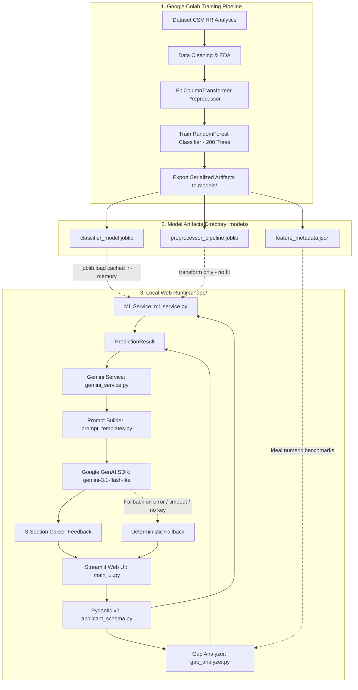
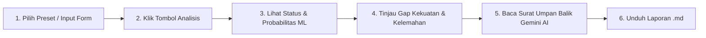

# SIKUKER: Sistem Klasifikasi Kesesuaian Kualifikasi Kerja Berdasarkan Machine Learning dengan Pemanfaatan Gemini API untuk Penyempurnaan Umpan Balik Karir

[](https://www.python.org/)
[](https://streamlit.io/)
[](https://scikit-learn.org/)
[-blueviolet.svg)](https://ai.google.dev/)
[-brightgreen.svg)](tests/)
[](docs/)

---

## 📌 Ringkasan Eksekutif (Executive Overview)

**SIKUKER** (*Sistem Klasifikasi Kesesuaian Kualifikasi Kerja*) adalah platform evaluasi kualifikasi pelamar kerja berbasis kecerdasan buatan (*Artificial Intelligence*) yang dirancang untuk mengatasi permasalahan klasik proses seleksi awal (*initial candidate screening*) di industri teknologi. 

Pada rekrutmen konvensional, kandidat yang tidak memenuhi kualifikasi sering kali hanya menerima surat penolakan otomatis bernada dingin (*generic cold rejection*) tanpa transparansi mengenai aspek kualifikasi mana yang belum memenuhi standar posisi yang dilamar. SIKUKER menjembatani celah ini dengan mengintegrasikan:
1. **Machine Learning Pipeline (Supervised Learning - Random Forest Classifier):** Memprediksi probabilitas kelayakan pelamar secara objektif, saintifik, dan mengelompokkannya ke dalam 3 tingkat keputusan (**Terima**, **Pertimbangan**, **Tolak**).
2. **Qualification Gap Analyzer:** Melakukan komparasi terperinci antara nilai fitur pelamar terhadap nilai acuan (*benchmark ideal*) median kandidat yang diterima.
3. **Generative AI Career Coach (Google Gemini API via Official `google-genai` SDK):** Menyusun surat umpan balik resmi yang empatik, santun, dan menyajikan rekomendasi materi pembelajaran (*upskilling roadmap*) terstruktur dalam Bahasa Indonesia profesional.

---

## 🚀 Fitur-Fitur Utama Sistem

| Fitur Utama | Deskripsi Teknis | Manfaat Bisnis & Pengguna |
| :--- | :--- | :--- |
| **3-Tier Decision Engine** | Memetakan probabilitas model ke status: **Terima** ($\ge 75\%$), **Pertimbangan** ($45\% - 74\%$), dan **Tolak** ($< 45\%$). | Memberikan kejelasan status seleksi tanpa keraguan biner (*reject-or-hire*). |
| **Qualification Gap Analyzer** | Mengidentifikasi selisih angka riil antara fitur profil pelamar dengan nilai benchmark ideal (IPK, skor tes, pengalaman, jam pelatihan, dan indeks kota). | Kandidat dan tim HR mengetahui secara transparan faktor pembeda kualifikasi. |
| **Generative Career Coach** | Memanfaatkan model Google Gemini (`gemini-3.1-flash-lite`) dengan rekayasa prompt peran *Senior HR & Recruiter*. | Menghasilkan umpan balik karir 3 bagian yang personal, santun, dan konstruktif. |
| **Zero-Crash Fallback Engine** | Mekanisme keselamatan otomatis yang merender *Deterministic Feedback Template* jika API key kosong, kuota habis, atau koneksi terputus. | Aplikasi web dijamin stabil, reliabel, dan tidak pernah mengalami *crash* di sisi pengguna. |
| **Smart Model Auto-Resolution** | Fitur resolusi alias cerdas yang memetakan nama model lawas (`gemini-2.5-flash`, dll.) langsung ke model modern aktif (`gemini-3.1-flash-lite`). | Menghilangkan penundaan error 404 dari Google dan menjamin kecepatan respon ~1.2 detik. |
| **1-Click Simulation Presets** | Tombol preset instan pada sidebar: *🟢 Kandidat Kuat*, *🟡 Kandidat Pertimbangan*, dan *🔴 Kandidat Kurang*. | Mempermudah demonstrasi dan verifikasi fungsionalitas dalam hitungan detik. |
| **Ekspor Laporan (.md)** | Fitur unduh laporan evaluasi lengkap pelamar dalam format Markdown terstruktur. | Memudahkan pengarsipan dokumen evaluasi oleh tim HR maupun pelamar kerja. |

---

## 🏛️ Arsitektur Sistem (Decoupled Pipeline Strategy)

Proyek ini menerapkan arsitektur terpisah (*Decoupled Architecture*) antara lingkungan pelatihan model (*Training Environment*) dan lingkungan aplikasi web (*Inference Runtime*) guna mematuhi standar rekayasa perangkat lunak modern:



> [!IMPORTANT]
> **Aturan Arsitektur Decoupled:** Modul aplikasi lokal di dalam folder `app/` **tidak pernah melakukan pelatihan (`.fit()`) model**. Aplikasi web hanya memuat artefak serialisasi yang sudah jadi dari folder `models/` dan mengeksekusi inferensi melalui `.transform()` dan `.predict_proba()`.

---

## 📊 Spesifikasi 9 Fitur Kualifikasi & Benchmark Ideal

Model klasifikasi dan sistem evaluasi kualifikasi memproses 9 parameter pelamar (5 fitur numerik dan 4 fitur kategorikal):

| No | Nama Fitur | Tipe Data | Rentang Valid | Benchmark Ideal | Aturan Evaluasi Gap & Kualifikasi |
| :-: | :--- | :---: | :---: | :---: | :--- |
| 1 | `gpa` | Float | $2.00 - 4.00$ | $3.45$ | IPK akademik terakhir. Selisih negatif ($< 3.45$) dicatat sebagai kelemahan. |
| 2 | `test_score` | Float | $0.0 - 100.0$ | $78.50$ | Skor ujian asesmen teknis/koding. Standar kelulusan teknis ideal adalah $\ge 78.5$. |
| 3 | `experience_years` | Float | $0.0 - 30.0$ | $12.00$ | Total tahun pengalaman kerja profesional. |
| 4 | `training_hours` | Float | $0.0 - 500.0$ | $50.00$ | Total jam pelatihan/kursus intensif yang telah diselesaikan kandidat. |
| 5 | `city_development_index` | Float | $0.40 - 1.00$ | $0.91$ | Indeks kemajuan ekosistem industri wilayah domisili pelamar. |
| 6 | `education_level` | String | *5 Opsi* | `Graduate`+ | Jenjang `Masters` dan `Phd` dinilai sangat unggul; `High School` terdeteksi sebagai gap. |
| 7 | `major_discipline` | String | *6 Opsi* | `STEM` | Latar belakang `STEM` atau `Business Degree` dinilai linear langsung dengan ranah data. |
| 8 | `relevent_experience` | String | *2 Opsi* | `Has relevent` | Opsi `No relevent experience` langsung masuk daftar kelemahan prioritas. |
| 9 | `enrolled_university` | String | *3 Opsi* | `no_enrollment` | Opsi `Full time course` terdeteksi membatasi alokasi jam kerja reguler kantor. |

---

## ⚖️ Aturan Bisnis Keputusan 3-Tier (BR-01)

Hasil prediksi probabilitas positif ($P$) dari model Machine Learning dikonversi menjadi keputusan 3 tingkat sebagai berikut:

$$\text{Status}(P) = \begin{cases} 
\mathbf{Terima} & \text{jika } P \ge 0.75 \\ 
\mathbf{Pertimbangan} & \text{jika } 0.45 \le P < 0.75 \\ 
\mathbf{Tolak} & \text{jika } P < 0.45 
\end{cases}$$

1. **Terima (Probabilitas $\ge 75\%$):** Profil kandidat sangat kuat dan melampaui benchmark. Direkomendasikan segera lanjut ke tahap wawancara akhir.
2. **Pertimbangan (Probabilitas $45\% - 74\%$):** Profil kandidat menjanjikan namun memiliki kesenjangan kualifikasi tertentu yang memerlukan review portofolio atau tes komplementer.
3. **Tolak (Probabilitas $< 45\%$):** Profil kandidat saat ini berada di bawah standar minimum posisi. Sistem menyajikan rencana peningkatan kualifikasi untuk persiapan ke depan.

---

## 🤖 Rekayasa Prompt Gemini AI & Format Output Umpan Balik

Layanan `gemini_service.py` mengonfigurasi `SYSTEM_INSTRUCTION` resmi dengan peran:
> *"Anda adalah Konsultan Karir HR Senior & Technical Recruiter profesional yang bertugas memberikan evaluasi kualifikasi pelamar kerja secara objektif, suportif, empatik, dan menggunakan Bahasa Indonesia formal yang santun."*

Laporan umpan balik karir diwajibkan memiliki **3 bagian Markdown terstruktur**:
* **Bagian 1: Ringkasan Evaluasi & Surat Umpan Balik Karir** — Menyampaikan apresiasi, hasil evaluasi seleksi, dan konteks keputusan seleksi.
* **Bagian 2: Analisis Kesenjangan Kualifikasi (Gap Analysis)** — Menjelaskan secara transparan kekuatan profil pelamar dan poin-poin kesenjangan kualifikasi terhadap benchmark ideal.
* **Bagian 3: Peta Jalan Pengembangan Diri & Rekomendasi Belajar (Upskilling Roadmap)** — Rekomendasi 3-5 langkah aksi nyata, kursus bersertifikasi, topik teknis (SQL, Python, MLOps, System Design), atau proyek portofolio aplikatif.

---

## 📂 Struktur Repositori Terperinci

```text
SIKUKER/
├── app/                                 # Direktori kode sumber aplikasi web lokal
│   ├── core/
│   │   ├── __init__.py                  # Inisialisasi package core
│   │   └── config.py                    # Pemuat variabel .env, konstanta threshold, & path artefak
│   ├── schemas/
│   │   ├── __init__.py                  # Inisialisasi package schemas
│   │   └── applicant_schema.py          # Validasi skema Pydantic v2 (ApplicantInput & PredictionResult)
│   ├── services/
│   │   ├── __init__.py                  # Inisialisasi package services
│   │   ├── gap_analyzer.py              # Logika gap analyzer numerik & kategorikal terhadap benchmark
│   │   ├── ml_service.py                # Loader artefak model, kalkulasi probabilitas, & status mapping
│   │   └── gemini_service.py            # Pemanggil Google GenAI SDK, fallback engine, & timeout handler
│   ├── utils/
│   │   ├── __init__.py                  # Inisialisasi package utils
│   │   └── prompt_templates.py          # Rekayasa prompt HR consultant & system instructions
│   └── main_ui.py                       # Antarmuka pengguna Streamlit (sidebar presets, form, metrics, cards)
├── colab_pipeline/                      # Direktori pipeline pelatihan model eksternal
│   └── SIKUKER_Training_Pipeline.ipynb  # Notebook Google Colab untuk EDA, pelatihan, & ekspor model
├── docs/                                # Dokumentasi formal SDLC Waterfall (Fase 1 s/d Fase 4)
│   ├── 01_requirements_spec.md          # Software Requirements Specification (SRS)
│   ├── 02_system_design.md              # Software Design Document (SDD)
│   ├── 03_implementation_guide.md       # Technical Implementation & Developer Guide
│   └── 04_testing_report.md             # Automated Testing & Quality Assurance Report
├── models/                              # Direktori artefak serialisasi model (Read-Only)
│   ├── classifier_model.joblib          # Model klasifikasi terlatih (RandomForestClassifier, 200 estimators)
│   ├── preprocessor_pipeline.joblib     # Pipeline ColumnTransformer Scikit-Learn
│   └── feature_metadata.json            # Metadata fitur, urutan kolom, kategori, & benchmark ideal
├── tests/                               # Direktori pengujian otomatis (Automated Unit Tests)
│   ├── __init__.py                      # Inisialisasi package tests
│   ├── test_gap_analyzer.py             # 4 unit tests untuk logika gap analysis numerik & kategorikal
│   ├── test_gemini_service.py           # 4 unit tests untuk prompt builder & fallback offline AI
│   ├── test_ml_service.py               # 6 unit tests untuk pemuatan artefak, threshold, & prediksi model
│   └── test_schemas.py                  # 16 unit tests untuk pengujian batas nilai ekstrim Pydantic v2
├── .env.example                         # Template konfigurasi variabel lingkungan
├── .gitignore                           # Berkas pengabaian git (mengabaikan .env, cache, & virtualenv)
├── PROSES.md                            # Log kronologis eksekusi SDLC Waterfall, audit, & verifikasi
├── PRD.md                               # Product Requirements Document awal
├── requirements.txt                     # Daftar dependensi pustaka Python terstandarisasi
└── README.md                            # Dokumentasi utama proyek
```

---

## 🛠️ Panduan Instalasi & Pengoperasian Lengkap

### Prasyarat Sistem
* **Sistem Operasi:** Windows 10/11, macOS, atau Linux.
* **Versi Python:** Python 3.10 hingga Python 3.13 (disarankan menggunakan *virtual environment*).
* **Koneksi Internet:** Diperlukan saat mengunduh pustaka dan saat memanggil Gemini API (opsional untuk inferensi ML lokal).

---

### Langkah 1: Kloning atau Buka Direktori Repositori
Buka terminal (PowerShell atau Command Prompt), lalu navigasikan ke folder repositori SIKUKER:
```bash
cd "d:/SEMESTER 7/SISTEM CERDAS/SIKUKER"
```

---

### Langkah 2: Pasang Dependensi Terstandarisasi
Pasang seluruh pustaka yang tercantum di berkas `requirements.txt`:
```bash
pip install -r requirements.txt
```

> [!CAUTION]
> **Penting Mengenai Versi Scikit-Learn:** Pustaka `scikit-learn` wajib menggunakan versi `1.6.1` (`scikit-learn==1.6.1`) persis seperti yang tertulis di `requirements.txt`. Versi yang tidak cocok (misalnya 1.9+) akan menimbulkan `AttributeError: Can't get attribute '_RemainderColsList'` saat memuat pipeline Colab.

---

### Langkah 3: Konfigurasi Variabel Lingkungan (`.env`)
Salin berkas template `.env.example` menjadi `.env`:
```bash
# Windows Command Prompt / PowerShell
copy .env.example .env

# Linux / macOS
cp .env.example .env
```

Buka file `.env` menggunakan teks editor (Notepad, VS Code, dll.) dan masukkan kunci API Gemini Anda:
```env
# Google Gemini API Configuration
GEMINI_API_KEY=your_actual_gemini_api_key_here
GEMINI_MODEL=gemini-3.1-flash-lite
```

> [!TIP]
> * Kunci API Gemini bisa didapatkan secara gratis di [Google AI Studio](https://aistudio.google.com/app/apikey).
> * Model yang sangat direkomendasikan adalah **`gemini-3.1-flash-lite`** karena aktif untuk seluruh akun baru dan memiliki kecepatan generasi hanya ~1.2 detik.
> * Jika `GEMINI_API_KEY` belum diisi, aplikasi **tetap dapat berjalan normal 100%** menggunakan *Local Deterministic Feedback Engine*.

---

### Langkah 4: Menjalankan Aplikasi Web Streamlit
Jalankan aplikasi web melalui terminal:
```bash
streamlit run app/main_ui.py
```
*(atau jika perintah `streamlit` tidak dikenali langsung di shell):*
```bash
python -m streamlit run app/main_ui.py
```

Setelah perintah dijalankan, server lokal akan aktif dan peramban web akan otomatis terbuka pada tautan:  
👉 **`http://localhost:8501`**

---

### Langkah 5: Menghentikan Server Aplikasi (Stop Server)
Untuk mematikan server Streamlit yang sedang berjalan:
* **Metode 1 (Terminal Terbuka):** Tekan kombinasi tombol `Ctrl + C` pada jendela terminal tempat Streamlit dijalankan.
* **Metode 2 (Terminal Tertutup / Port 8501 Menggantung):** Jalankan perintah PowerShell berikut untuk menghentikan proses:
  ```powershell
  Stop-Process -Id (Get-NetTCPConnection -LocalPort 8501).OwningProcess -Force
  ```
* **Metode 3 (Windows Task Manager):** Tekan `Ctrl + Shift + Esc`, cari proses **Python**, lalu klik **End Task**.

---

## 🖥️ Panduan Penggunaan Antarmuka Web (User Guide)

Setelah aplikasi terbuka di peramban, ikuti langkah penggunaan berikut:



### 1. Memanfaatkan Tombol Preset Cepat (Sidebar)
Pada bilah samping (*Sidebar*), klik salah satu tombol preset untuk menguji profil simulasi secara instan:
* **🟢 Isi Contoh Kandidat Kuat:** Mengisi data profil dengan IPK 3.85, skor tes 92, pengalaman 4.5 tahun, jam pelatihan 60 jam, dan latar belakang STEM. (*Prediksi: Terima / Lolos $\ge 95\%$*).
* **🟡 Isi Contoh Kandidat Pertimbangan:** Mengisi data profil bernilai menengah dengan pengalaman relevan terbatas. (*Prediksi: Dalam Pertimbangan $45\% - 74\%$*).
* **🔴 Isi Contoh Kandidat Kurang:** Mengisi data profil dengan IPK 2.50, skor tes 45, pengalaman minim, dan tanpa jam pelatihan. (*Prediksi: Tolak $< 45\%$*).

### 2. Memasukkan Data Kualifikasi Pelamar Mandiri
Isi formulir pada halaman utama:
* Masukkan **Nama Lengkap Pelamar** dan **Posisi yang Dilamar** (default: *Data Scientist / ML Engineer*).
* Tentukan nilai numerik menggunakan slider dan kolom input (IPK, Skor Tes, Pengalaman, Jam Pelatihan, City Development Index).
* Pilih opsi tingkat pendidikan, jurusan, pengalaman relevan, dan status perkuliahan melalui dropdown select box.

### 3. Menjalankan Analisis & Membaca Hasil
* Klik tombol **`🚀 Jalankan Analisis Kualifikasi & Umpan Balik AI`**.
* Dalam waktu 1-2 detik, hasil analisis akan muncul di layar:
  1. **Tiga Kartu Metrik:** Status Kelayakan Pelamar, Persentase Skor Probabilitas, dan Indikator Status Kesiapan Kerja.
  2. **Dua Kolom Komparasi Kualifikasi:** Kolom hijau menampilkan poin kekuatan kualifikasi yang melampaui benchmark; kolom oranye menampilkan poin kesenjangan kualifikasi yang perlu ditingkatkan.
  3. **Kotak Laporan Umpan Balik Karir AI:** Menampilkan surat evaluasi resmi 3 bagian yang disusun oleh Gemini AI.
* Klik tombol **`📥 Unduh Laporan Evaluasi Karir (.md)`** di bagian bawah untuk menyimpan berkas laporan lengkap.

---

## 🧪 Pengujian Otomatis Suite (30 Unit Tests Passed)

Suite pengujian otomatis dibangun menggunakan pustaka `pytest` dengan cakupan 30 kasus uji independen:

```bash
python -m pytest -v
```

### Matriks Pengujian Unit (Test Coverage Matrix)

| Berkas Pengujian | Jumlah Uji | Fokus Pengujian & Cakupan Kasus Uji | Status |
| :--- | :---: | :--- | :---: |
| `tests/test_ml_service.py` | 6 | Pemuatan artefak model, rentang probabilitas $0.0 - 1.0$, akurasi pemetaan 3-tier threshold (`Terima`, `Pertimbangan`, `Tolak`), dan integritas struktur DataFrame. | **PASSED** (100%) |
| `tests/test_gap_analyzer.py` | 4 | Deteksi kelemahan numerik di bawah benchmark, deteksi kekuatan kualifikasi, aturan kategorikal, dan ketahanan terhadap metadata kosong. | **PASSED** (100%) |
| `tests/test_gemini_service.py` | 4 | Integritas instruksi sistem, pembentukan prompt terstruktur, render deterministik 3 bagian, dan penanganan saat API key kosong. | **PASSED** (100%) |
| `tests/test_schemas.py` | 16 | Validasi nilai batas ekstrim Pydantic v2 (IPK di luar 2.0-4.0, skor tes di luar 0-100, jam pelatihan di luar 0-500, pengalaman kerja, indeks kota, dan kategori tidak valid). | **PASSED** (100%) |
| **Total Keseluruhan** | **30** | **Cakupan end-to-end inferensi, analisis gap, validasi data, dan AI feedback.** | **PASSED (100%)** |

Cuplikan hasil eksekusi resmi di terminal:
```text
============================= test session starts =============================
platform win32 -- Python 3.13.14, pytest-9.1.1, pluggy-1.7.0 -- python.exe
cachedir: .pytest_cache
rootdir: D:\SEMESTER 7\SISTEM CERDAS\SIKUKER
plugins: anyio-4.14.1
collecting ... collected 30 items

tests/test_gap_analyzer.py::test_gap_analyzer_identifies_numeric_weaknesses PASSED [  3%]
tests/test_gap_analyzer.py::test_gap_analyzer_identifies_numeric_strengths PASSED [  6%]
tests/test_gap_analyzer.py::test_gap_analyzer_categorical_rules PASSED   [ 10%]
tests/test_gap_analyzer.py::test_gap_analyzer_handles_empty_metadata PASSED [ 13%]
tests/test_gemini_service.py::test_system_instruction PASSED             [ 16%]
tests/test_gemini_service.py::test_build_career_feedback_prompt PASSED   [ 20%]
tests/test_gemini_service.py::test_generate_fallback_feedback_sections PASSED [ 23%]
tests/test_gemini_service.py::test_generate_career_feedback_fallback_on_missing_key PASSED [ 26%]
tests/test_ml_service.py::test_load_ml_artifacts PASSED                  [ 30%]
tests/test_ml_service.py::test_map_probability_to_status PASSED          [ 33%]
tests/test_ml_service.py::test_predict_strong_candidate PASSED           [ 36%]
tests/test_ml_service.py::test_predict_moderate_candidate PASSED         [ 40%]
tests/test_ml_service.py::test_predict_weak_candidate PASSED             [ 43%]
tests/test_ml_service.py::test_applicant_dataframe_structure PASSED      [ 46%]
tests/test_schemas.py::test_valid_applicant_input PASSED                 [ 50%]
tests/test_schemas.py::test_invalid_applicant_input_bounds[gpa-1.99] PASSED [ 53%]
tests/test_schemas.py::test_invalid_applicant_input_bounds[gpa-4.01] PASSED [ 56%]
tests/test_schemas.py::test_invalid_applicant_input_bounds[test_score--1.0] PASSED [ 60%]
tests/test_schemas.py::test_invalid_applicant_input_bounds[test_score-100.1] PASSED [ 63%]
tests/test_schemas.py::test_invalid_applicant_input_bounds[experience_years--0.5] PASSED [ 66%]
tests/test_schemas.py::test_invalid_applicant_input_bounds[experience_years-30.5] PASSED [ 70%]
tests/test_schemas.py::test_invalid_applicant_input_bounds[training_hours--1.0] PASSED [ 73%]
tests/test_schemas.py::test_invalid_applicant_input_bounds[training_hours-501.0] PASSED [ 76%]
tests/test_schemas.py::test_invalid_applicant_input_bounds[city_development_index-0.39] PASSED [ 80%]
tests/test_schemas.py::test_invalid_applicant_input_bounds[city_development_index-1.01] PASSED [ 83%]
tests/test_schemas.py::test_invalid_applicant_input_bounds[education_level-Diploma] PASSED [ 86%]
tests/test_schemas.py::test_invalid_applicant_input_bounds[major_discipline-Law] PASSED [ 90%]
tests/test_schemas.py::test_invalid_applicant_input_bounds[relevent_experience-Some experience] PASSED [ 93%]
tests/test_schemas.py::test_invalid_applicant_input_bounds[enrolled_university-Online course] PASSED [ 96%]
tests/test_schemas.py::test_prediction_result_validation PASSED          [100%]

============================= 30 passed in 2.48s ==============================
```

---

## ❓ Panduan Penyelesaian Masalah (Troubleshooting & FAQ)

### 1. Muncul `AttributeError: Can't get attribute '_RemainderColsList'` saat memuat model
* **Penyebab:** Versi pustaka `scikit-learn` pada lingkungan lokal berbeda dengan versi saat model diekspor dari Google Colab.
* **Solusi:** Jalankan `pip install scikit-learn==1.6.1` untuk memastikan keselarasan versi artefak `.joblib`.

### 2. Log menampilkan pesan `Attempt with model ... failed (timed out)`
* **Penyebab:** Koneksi jaringan mengalami latensi atau pengaturan timeout API terlalu singkat.
* **Solusi:** Sistem SIKUKER sudah dilengkapi pengaturan `timeout=25000` (25 detik) dan resolusi model cerdas ke `gemini-3.1-flash-lite`. Pastikan koneksi internet Anda stabil atau gunakan mode fallback deterministik yang otomatis aktif.

### 3. Server Streamlit tidak bisa dijalankan karena port 8501 sedang dipakai
* **Penyebab:** Ada proses Streamlit sebelumnya yang belum ditutup sempurna.
* **Solusi:** Buka PowerShell dan hentikan proses pada port 8501 dengan perintah:
  ```powershell
  Stop-Process -Id (Get-NetTCPConnection -LocalPort 8501).OwningProcess -Force
  ```

### 4. Apakah aplikasi bisa berjalan jika tidak memiliki kunci API Gemini?
* **Jawaban:** **Bisa 100%.** SIKUKER memiliki *Deterministic Fallback Engine* di [app/services/gemini_service.py](file:///d:/SEMESTER%207/SISTEM%20CERDAS/SIKUKER/app/services/gemini_service.py). Jika kunci API tidak diisi, surat evaluasi karir dan rekomendasi belajar tetap tersusun secara otomatis berbasis aturan kesenjangan kualifikasi.

---

## 📚 Tautan Dokumentasi Formal SDLC Waterfall

Dokumentasi proyek dikembangkan secara komprehensif mengikuti metodologi rekayasa perangkat lunak sekuensial (SDLC Waterfall) pada direktori `docs/`:

1. [**01_requirements_spec.md**](docs/01_requirements_spec.md) — *Software Requirements Specification (SRS):* Latar belakang, persona pengguna, spesifikasi 9 fitur masukan, kebutuhan fungsional (FR-01 s/d FR-07), kebutuhan non-fungsional (NFR-01 s/d NFR-04), dan aturan bisnis (BR-01 s/d BR-03).
2. [**02_system_design.md**](docs/02_system_design.md) — *Software Design Document (SDD):* Diagram arsitektur terpisah (*Decoupled Pipeline*), diagram komponen berlapis, spesifikasi preprocessing dan algoritma Random Forest, desain prompt engineering, dan arsitektur resiliensi fallback.
3. [**03_implementation_guide.md**](docs/03_implementation_guide.md) — *Technical Implementation Guide:* Struktur direktori, panduan instalasi dependensi, panduan konfigurasi `.env`, detail implementasi modul core/services/ui, tata cara eksekusi server, dan perintah stop server.
4. [**04_testing_report.md**](docs/04_testing_report.md) — *Automated Testing & QA Report:* Rencana pengujian, matriks 30 kasus uji unit, verifikasi kriteria penerimaan, dan hasil uji regresi.
5. [**PROSES.md**](PROSES.md) — *Engineering Execution Log:* Rekam jejak kronologis pelaksanaan proyek per fase Waterfall (Fase 1 hingga Fase 4.2), audit bug, dan log verifikasi.

---

## 👨‍💻 Informasi Proyek & Pengembang

* **Judul Proyek:** SIKUKER (Sistem Klasifikasi Kesesuaian Kualifikasi Kerja Berdasarkan Machine Learning dengan Pemanfaatan Gemini API untuk Penyempurnaan Umpan Balik Karir)
* **Mata Kuliah:** Sistem Cerdas — Semester 7
* **Tahun Akademik:** 2026/2027
