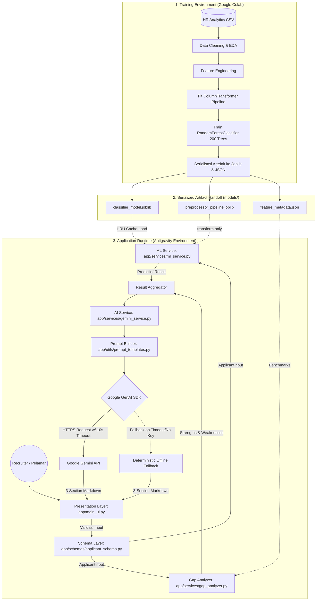
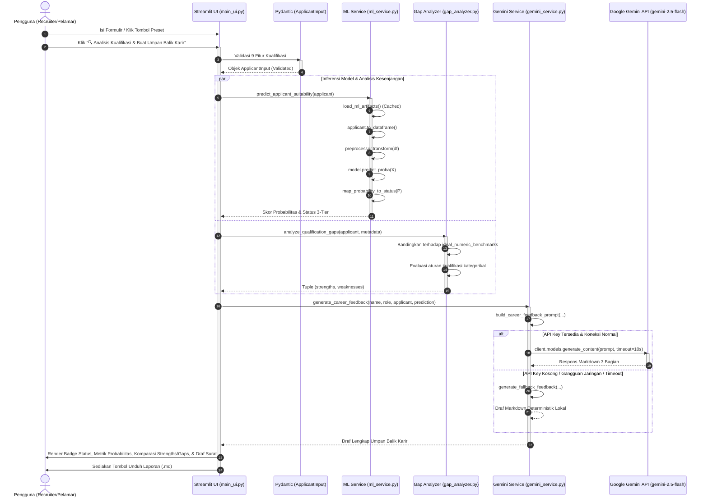

# System & Software Design Document (SDD)
# SIKUKER: Sistem Klasifikasi Kesesuaian Kualifikasi Kerja Berdasarkan Machine Learning dengan Pemanfaatan Gemini API untuk Penyempurnaan Umpan Balik Karir

- **Dokumen Identifikasi:** SDD-SIKUKER-02
- **Fase SDLC:** Fase 2 — System & Software Design
- **Status Dokumen:** Baseline / Approved
- **Versi Dokumen:** 2.0.0 (Comprehensive Expansion)
- **Terakhir Diperbarui:** 26 Oktober 2026

---

## 1. Arsitektur Global & Filosofi Desain (Architectural Overview)

SIKUKER dirancang dengan menerapkan dua prinsip rekayasa perangkat lunak modern:
1. **Decoupled Pipeline Strategy:** Memisahkan beban komputasi berat pelatihan model (*Google Colab ML Pipeline*) dari lingkungan eksekusi inferensi web lokal (*Antigravity Streamlit Web App*). Model hanya diekspor sekali ke dalam format artefak terstandarisasi, dan runtime web bersifat *read-only* murni terhadap model tersebut.
2. **Layered Separation of Concerns (SoC):** Membagi kode aplikasi secara modular ke dalam 4 lapisan independen: *Presentation Layer*, *Service Layer*, *Schema/Validation Layer*, dan *Configuration Layer*.



---

## 2. Diagram Alur & Interaksi Sistem (Sequence Diagram)

Diagram berikut memvisualisasikan interaksi antar-komponen saat pengguna menekan tombol analisis pada antarmuka web:



---

## 3. Rincian Desain Arsitektur Komponen

### 3.1 Lapisan Presentasi (`app/main_ui.py`)
- **Tanggung Jawab:** Menyediakan antarmuka visual yang modern, responsif, dan mudah dipahami pengguna tanpa logika bisnis backend langsung.
- **Manajemen Sesi (`st.session_state`):**
  - Menyimpan status preset aktif (`applicant_name`, `target_role`, `gpa`, `test_score`, `experience_years`, `training_hours`, `city_development_index`, `education_level`, `major_discipline`, `relevent_experience`, `enrolled_university`).
  - Menyimpan hasil komputasi aktif (`prediction_result` dan `career_feedback`) agar data tetap persisten selama re-render Streamlit.
- **Komponen Visual:**
  - Kartu badge bersinar dengan skema warna tri-kromatik: Hijau (`#10b981`), Kuning/Oranye (`#f59e0b`), dan Merah (`#ef4444`).
  - Bar meter probabilitas kelayakan kerja.
  - Komparasi dua kolom berdampingan (*Strengths vs Qualification Gaps*).
  - Tombol ekspor laporan resmi berekstensi `.md`.

### 3.2 Lapisan Data & Skema (`app/schemas/applicant_schema.py`)
- **`ApplicantInput`:** Skema Pydantic v2 dengan batasan validasi ketat:
  ```python
  class ApplicantInput(BaseModel):
      gpa: float = Field(..., ge=2.0, le=4.0)
      test_score: float = Field(..., ge=0.0, le=100.0)
      experience_years: float = Field(..., ge=0.0, le=30.0)
      training_hours: float = Field(..., ge=0.0, le=500.0)
      city_development_index: float = Field(..., ge=0.4, le=1.0)
      education_level: Literal["Graduate", "Masters", "Phd", "High School", "Primary School"]
      major_discipline: Literal["STEM", "Business Degree", "Arts", "Humanities", "No Major", "Other"]
      relevent_experience: Literal["Has relevent experience", "No relevent experience"]
      enrolled_university: Literal["no_enrollment", "Full time course", "Part time course"]
  ```
- **`PredictionResult`:** Menampung hasil komputasi model dan gap analyzer:
  - `probability`: float ($0.0 - 1.0$)
  - `percentage`: float ($0.0 - 100.0\%$)
  - `status`: `Literal["Terima", "Pertimbangan", "Tolak"]`
  - `strengths`: list string keunggulan
  - `weaknesses`: list string kesenjangan/kelemahan

### 3.3 Lapisan Layanan Machine Learning (`app/services/ml_service.py`)
- **Cache In-Memory:** Menggunakan `@functools.lru_cache(maxsize=1)` pada fungsi `load_ml_artifacts()` untuk mengeliminasi pemanggilan `joblib.load()` berulang pada setiap interaksi pengguna.
- **Mekanisme Mock/Fallback:** Menyediakan class `MockModel` dan `MockPreprocessor` yang memicu kalkulasi skor kualifikasi heuristik tertimbang jika artefak `.joblib` tidak ditemukan, menjamin stabilitas aplikasi.
- **Aturan Pemetaan Status 3-Tier:**
  $$\text{Status}(P) = \begin{cases} 
  \text{"Terima"}, & P \ge 0.75 \\ 
  \text{"Pertimbangan"}, & 0.45 \le P < 0.75 \\ 
  \text{"Tolak"}, & P < 0.45 
  \end{cases}$$

### 3.4 Lapisan Penganalisis Kesenjangan (`app/services/gap_analyzer.py`)
- **Analisis Kuantitatif:** Membandingkan nilai numerik kandidat terhadap median kandidat lolos pada `models/feature_metadata.json`:
  - GPA / IPK: $3.45$
  - Skor Tes Teknis: $78.5$
  - Pengalaman Kerja: $12.0$ tahun
  - Jam Pelatihan: $50.0$ jam
  - Indeks Kota: $0.91$
- Menghitung nilai selisih (*gap delta*) secara eksplisit: $\Delta = \text{Benchmark} - \text{Nilai Kandidat}$.
- **Analisis Kualitatif:** Mengevaluasi korelasi jurusan (STEM vs non-STEM), tingkat pendidikan (Sarjana/Pascasarjana vs SMA), relevansi pengalaman, dan ketersediaan waktu kerja reguler.

### 3.5 Lapisan Integrasi AI & Ketahanan Model (`app/services/gemini_service.py`)
- **SDK Resmi:** Menggunakan pustaka Google GenAI SDK terbaru (`google-genai`).
- **Hierarki Model Cerdas (*Multi-Model Resilience*):**
  Untuk mengantisipasi deprecasi nama model di API Google Cloud, sistem menerapkan antrean model alternatif secara berurutan:
  1. Model konfigurasi utama (`os.getenv("GEMINI_MODEL", "gemini-2.5-flash")`).
  2. `gemini-3.8-flash` (Rekomendasi model terbaru Google API).
  3. `gemini-2.0-flash`.
  4. `gemini-1.5-flash`.
- **Kontrol Batas Waktu (*Network Timeout*):** Menetapkan `types.HttpOptions(timeout=10.0)` untuk menjamin antarmuka tidak membeku jika koneksi internet pengguna terputus.
- **Mesin Fallback Offline Deterministik:** Menghasilkan draf umpan balik karir komprehensif dalam Bahasa Indonesia yang secara dinamis menyematkan kelemahan spesifik pelamar dan rekomendasi kursus yang tepat sasaran jika pemanggilan API gagal total.

---

## 4. Desain Pipeline Prapemrosesan & Klasifikasi Data

Model dilatih di Google Colab menggunakan arsitektur *Scikit-Learn Pipeline*:

```text
Input Raw Features (9 Kolom)
│
├── [NUMERIK] (5 Kolom: gpa, test_score, experience_years, training_hours, city_development_index)
│     ├── SimpleImputer(strategy='median')
│     └── StandardScaler()
│
└── [KATEGORIKAL] (4 Kolom: education_level, major_discipline, relevent_experience, enrolled_university)
      ├── SimpleImputer(strategy='most_frequent')
      └── OneHotEncoder(handle_unknown='ignore', sparse_output=False)
│
▼
ColumnTransformer (Output: Vektor Fitur 21 Dimensi)
│
▼
RandomForestClassifier(n_estimators=200, random_state=42)
│
▼
predict_proba(X)[0][1] ──► Probabilitas Kelas 1 (Kesesuaian Kualifikasi)
```

---

## 5. Desain Prompt Engineering

### 5.1 System Instruction
```text
Anda adalah seorang Konsultan Karir HR Senior & Technical Recruiter berpengalaman di industri teknologi.
Tugas utama Anda adalah menyusun umpan balik karir yang objektif, mendalam, konstruktif, dan memberdayakan
berdasarkan data kualifikasi kandidat serta hasil prediksi model Machine Learning.
Gunakan Bahasa Indonesia formal yang santun, empatik, dan profesional.
Fokuslah pada solusi nyata dan langkah aksionabel yang dapat segera diambil oleh pelamar
untuk meningkatkan daya saing profesional mereka.
```

### 5.2 Format Kontrak Tiga Bagian Output Markdown
1. **### 1. Ringkasan Evaluasi & Surat Umpan Balik Karir:** Draf komunikasi resmi yang disesuaikan dengan status (`Terima` bernada apresiasi & offering, `Pertimbangan` bernada objektif & tes lanjutan, `Tolak` bernada empatik & membesarkan hati).
2. **### 2. Analisis Kesenjangan Kualifikasi (Gap Analysis):** Uraian mendalam mengapa kesenjangan kualifikasi yang terdeteksi berpengaruh pada kesiapan kerja teknis.
3. **### 3. Peta Jalan Pengembangan Diri & Rekomendasi Materi Belajar (Upskilling):** 3 hingga 5 rekomendasi konkret mencakup kursus daring bereputasi (Coursera, DeepLearning.AI), ide portofolio nyata di GitHub, dan sertifikasi industri resmi.
